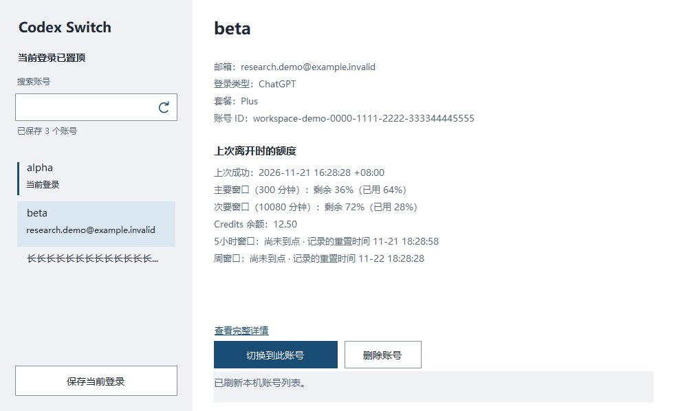

# Codex 账号切换器

在 Windows 上用桌面窗口或 cmd 管理本机 Codex 账号。当前登录始终置顶，选择另一行可以先核对邮箱、账号 ID、套餐和额度快照，再决定是否切换。



## 下载与启动

**v0.4.0 安全提示**　本机 Microsoft Defender 已隔离本版的 `codex-switch.exe` 和 `installer.exe`。请暂停使用这两个附件及包含它们的 npm 包。需要图形界面时，可使用单独的便携桌面端 `CodexSwitch.exe`，该文件在本次单文件扫描中未检出威胁。

从 [GitHub Releases](https://github.com/Veiluna/codex-switch/releases/latest) 下载 Windows x64 版本。

| 文件 | 用法 |
| --- | --- |
| `installer.exe` | 双击打开图形安装器。为当前用户安装两个入口后，可从开始菜单打开桌面端，在新终端运行 `codex-switch`。 |
| `veiluna-codex-switch-0.4.2.tgz` | npm 格式的 Windows x64 包，内含同版 CLI 及安装器，支持 npm 和 npx。 |
| `CodexSwitch.exe` | 便携桌面端。双击打开。 |
| `codex-switch.exe` | 便携命令行。可在 cmd 或 PowerShell 中单独运行。 |

使用系统 .NET Framework 4.8 和 Windows PowerShell 5.1。分发文件未签名，发布页提供 SHA-256。安装、升级和卸载均保留账号目录。需要使用 Codex 的本地文件凭据，默认目录为 `%USERPROFILE%\.codex`，也可以指定 `CODEX_HOME`。

### 图形安装和命令行安装

下载 `installer.exe` 后可离线使用。双击进入中文确认窗口。要在脚本中静默安装并等待完成，在下载目录的 cmd 里运行：

```cmd
start "" /wait ".\installer.exe" install --quiet
echo %ERRORLEVEL%
```

PowerShell 可用 `(Start-Process .\installer.exe -ArgumentList 'install','--quiet' -Wait -PassThru).ExitCode`。静默卸载将 `install` 改为 `uninstall`。安装和卸载成功返回 0，运行失败返回 1，参数错误返回 2。也可从 Windows 设置 → 应用 → 已安装的应用卸载。

**从 0.3 MSI 迁移**：先在 Windows「已安装的应用」中卸载旧版 Codex Switch，再运行新版安装器。新程序会识别旧版安装登记，账号文件继续保存在原来的 Codex 目录。

### 用 npm 或 npx 获取

以下为后续通过安全验收的版本保留安装示例。将 `X.Y.Z` 替换为已核验的新版本号，在下载目录打开终端。长期使用 CLI 可执行：

```console
npm install --global ".\veiluna-codex-switch-X.Y.Z.tgz"
codex-switch --help
```

偶尔使用可直接运行一次：

```console
npx --yes --package=".\veiluna-codex-switch-X.Y.Z.tgz" -- codex-switch list
```

将末尾的 `codex-switch list` 换成 `codex-switch-install` 可打开图形安装器，换成 `codex-switch-install install --quiet` 可静默安装。Windows 安装器管理桌面安装，npm 管理由它安装的命令入口，可用 `npm uninstall --global @veiluna/codex-switch` 移除。

## 第一次使用

1. 在 Codex 中正常登录。回到切换器，点击搜索框右侧的刷新箭头，查看当前登录身份。
2. 点击 **保存当前登录**。默认名称为邮箱，也可以自行命名。再次保存可验证为同一身份的账号时更新已有存档。工具兼容已有的 `<名称>_auth.json` 和 `<名称>.json`。
3. 在列表中选择目标，在右侧核对详情后点击 **切换到此账号**。蓝色标记指示当前登录，所选行决定右侧显示的详情。要移除本地存档，选择 **删除账号** 并核对名称。

## 切换与额度

如果 Codex 桌面端正在运行，工具会询问是否正常关闭。正常退出超时后，强制结束需要单独确认，可能中断任务。原桌面端成功关闭后，工具读取最后写入的活动凭据，保存原账号，采集它的额度快照，再切换本地登录并尝试重开原桌面端。原本已关闭时保持关闭。

凭据保存失败会中止切换。额度服务不可用时继续切换，并保留上一次成功采集的数值、时间及最近失败记录。浏览、搜索和刷新账号列表仅重读本机信息。窗口重置点到达时显示提醒，实际剩余量以之后取得的新快照为准。API 密钥的账单额度请通过其计费渠道查询。[数据来源与字段](docs/native-account-data.md)

切换前的本地备份保存在 `accounts\backup-…_auth.json`。个人 `auth.json`、存档和备份均含敏感凭据，请单独保管。需要恢复时先退出 Codex，另存当前活动文件，再用选定备份恢复它。

## 命令行

```cmd
codex-switch
codex-switch list
codex-switch current
codex-switch show "工作账号"
codex-switch save "工作账号"
codex-switch switch "备用账号"
codex-switch delete "旧账号"
```

直接在终端运行可用方向键与 Enter 选择，Esc 退出。输出重定向时显示名单。账号名也可作为快捷切换命令。无人值守脚本用 `--allow-close` 授权正常退出，确实接受强制结束时另加 `--force-close`。脚本删除需加 `--yes`。退出码 0 表示成功，1 表示操作失败或取消，2 表示参数错误。使用 `--root "绝对目录"` 可指定独立目录，完整选项见 `codex-switch --help`。

## 从源码构建

在 Windows x64 上运行 `build.cmd`。产物和构建记录位于 `dist`。两个 C# 入口使用同一份共享核心；其中嵌入已经验证的 PowerShell 文件操作和桌面管理代码。构建与安装验证见[分发说明](installer/README.md)。账号功能见 [0.3 规格](https://github.com/Veiluna/codex-switch/issues/1)，安装和分发见 [0.4 规格与开发票](https://github.com/Veiluna/codex-switch/issues/8)。
