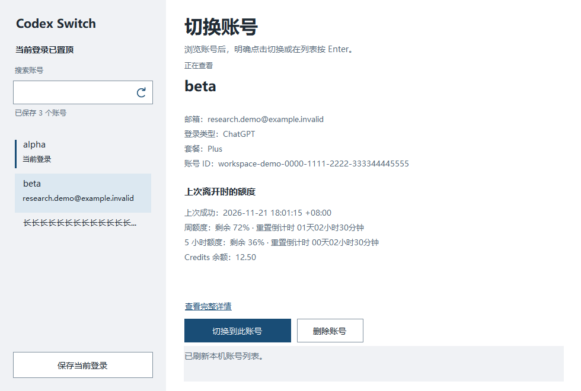

# Codex 账号切换器

在 Windows 上用桌面窗口或 cmd 管理本机 Codex 账号。当前登录始终置顶，选择另一行可以先核对邮箱、账号 ID、套餐和额度快照，再决定是否切换。



## 下载与安装

从 [GitHub 最新发布页](https://github.com/Veiluna/codex-switch/releases/latest) 下载 Windows x64 安装程序。v0.4.4 的文件名为 `CodexSwitch-Setup-0.4.4-x64.exe`。

双击安装器，在“桌面端”和“命令行（CLI）”中至少选择一项。首次安装默认全选，重新打开安装器会显示已安装的组件。桌面端会创建开始菜单快捷方式；CLI 安装完成后，可在新开的终端运行 `codex-switch`。再次运行安装器可以增减组件。

安装到当前 Windows 用户，使用系统 .NET Framework 4.8 和 Windows PowerShell 5.1。分发文件未签名。安装、升级和卸载均保留本机账号目录，默认路径为 `%USERPROFILE%\.codex`，也可以通过 `CODEX_HOME` 指定。

### 命令行安装

在下载目录的 cmd 中只安装 CLI 并等待安装完成：

```cmd
start "" /wait ".\CodexSwitch-Setup-0.4.4-x64.exe" install --quiet --components cli
echo %ERRORLEVEL%
```

`--components` 接受 `desktop`、`cli` 或 `desktop,cli`。省略该选项时，首次安装选择两项，升级保留已有选择。安装或卸载成功返回 0，运行失败返回 1，参数错误返回 2。

在 Windows 设置 → 应用 → 已安装的应用中选择 Codex Switch 可卸载，也可以运行安装器并传入 `uninstall --quiet`。从旧版 0.3 MSI 迁移时，先在“已安装的应用”卸载旧版，再运行新版安装器。

**旧版本提示**　本机 Microsoft Defender 曾隔离 v0.4.0 的 CLI 和安装器。仍持有该版本的用户请下载最新版安装程序。

## 第一次使用

1. 在 Codex 中正常登录。回到切换器，点击搜索框右侧的刷新箭头，查看当前登录身份。
2. 点击 **保存当前登录**。默认名称为邮箱，也可以自行命名。再次保存可验证为同一身份的账号时更新已有存档。工具兼容已有的 `<名称>_auth.json` 和 `<名称>.json`。
3. 在列表中选择目标，在右侧核对详情后点击 **切换到此账号**。蓝色标记指示当前登录，所选行决定右侧显示的详情。要移除本地存档，选择 **删除账号** 并核对名称。

在桌面端点击最小化会将窗口收进 Windows 通知区域。双击托盘图标，或右键选择“打开 Codex Switch”，即可恢复原窗口。关闭窗口或从托盘菜单选择“退出”会结束程序。

## 切换与额度

**切换不同账号。** 在图形界面点击切换后，工具直接请求正在运行的 Codex 正常退出。只有退出超时、需要强制结束进程时才询问一次。退出后工具保存原账号最后写入的凭据和额度，再切换并尝试重开客户端。客户端原本已关闭时，直接切换本地登录。

**同一账号切换个人空间和工作空间。** 如果客户端正在运行且可以核实两个空间属于同一用户，工具保存离开前的快照，保持 Codex 打开。按提示在 Codex 的账号菜单中选择目标空间，回到切换器后会自动核对当前身份，也可以点击刷新。只有读到目标用户和空间才显示切换成功。

**额度。** 有周期信息的快照优先显示周额度，其次是 5 小时额度。重置倒计时显示天、小时、分钟，例如 `05天05小时08分钟`。最后不足一分钟显示 `00天00小时01分钟`，到点显示 `00天00小时00分钟`。缺少重置时间时显示未知。

凭据保存失败会中止切换。额度服务不可用时继续切换，并保留上一次成功采集的数值、时间及最近失败记录。浏览、搜索和刷新账号列表仅重读本机信息。窗口重置点到达时显示提醒，实际剩余量以之后取得的新快照为准。API 密钥的账单额度请通过其计费渠道查询。[数据来源与字段](docs/native-account-data.md)

切换前的本地备份保存在 `accounts\backup-…_auth.json`。个人 `auth.json`、存档和备份均含敏感凭据，请单独保管。需要恢复时先退出 Codex，另存当前活动文件，再用选定备份恢复它。

## 命令行

```cmd
codex-switch
codex-switch list
codex-switch current
codex-switch show "工作账号"
codex-switch save "工作账号"
codex-switch switch "备用账号"
codex-switch delete "旧账号"
```

直接在终端运行可用方向键与 Enter 选择，Esc 退出。输出重定向时显示名单。账号名也可作为快捷切换命令。无人值守脚本用 `--allow-close` 授权正常退出，确实接受强制结束时另加 `--force-close`。脚本删除需加 `--yes`。退出码 0 表示成功，1 表示操作未完成（包括需要到 Codex 选择工作空间），2 表示参数错误。手动选好工作空间后可运行 `codex-switch current` 核对。使用 `--root "绝对目录"` 可指定独立目录，完整选项见 `codex-switch --help`。

## 从源码构建

在 Windows x64 上运行 `build.cmd`。产物和构建记录位于 `dist`。两个 C# 入口使用同一份共享核心；其中嵌入已经验证的 PowerShell 文件操作和桌面管理代码。构建与安装验证见[分发说明](installer/README.md)。账号功能见 [0.3 规格](https://github.com/Veiluna/codex-switch/issues/1)，安装和分发见 [0.4 规格与开发票](https://github.com/Veiluna/codex-switch/issues/8)。
