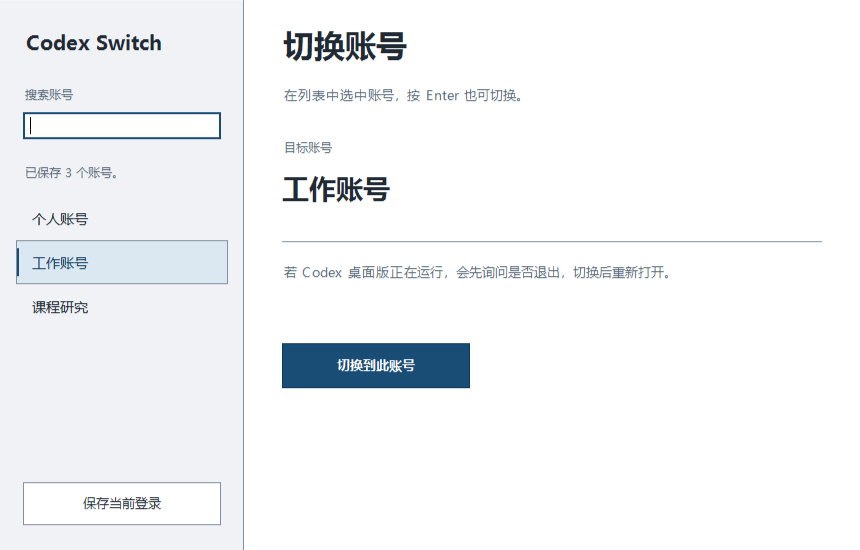

# Codex 账号切换器

在 Windows 本地窗口中，为当前 Codex 登录起名保存，以后点击账号名称即可切换。已有的 `<名称>_auth.json` 和 `<名称>.json` 存档会自动出现在列表里。



## 下载与启动

1. 在 [GitHub Releases](https://github.com/Veiluna/codex-switch/releases) 下载 `codex-switch-windows.zip`。
2. 把 ZIP 完整解压到一个文件夹。双击其中的 **Open-Codex-Switch.cmd**。
3. 第一次使用时，先在 Codex 中登录，点击窗口中的 **保存当前登录**，输入一个便于辨认的名称。已有存档的用户可以直接点击列表中的账号。

工具使用 Windows PowerShell 5.1 和 Windows Forms。切换依赖 Codex 的本地文件凭据模式，默认使用 `%USERPROFILE%\.codex\auth.json`，也支持用 `CODEX_HOME` 指定目录。使用系统凭据库的配置不能通过替换这个文件完成切换。

## 点击账号后会发生什么

| 当前状态 | 工具行为 |
| --- | --- |
| Codex 桌面端已关闭 | 切换本机凭据，保持桌面端关闭。 |
| Codex 桌面端正在运行 | 显示目标名称并请求确认。确认后尝试正常退出，成功切换后重新打开桌面端。 |
| 桌面端未能正常退出 | 再次询问是否强制关闭。强制关闭可能中断正在运行的任务。选择取消会保留原登录。 |
| 已切换但桌面端重开失败 | 窗口会单独报告重启结果，可以自行从开始菜单打开 Codex。 |

账号名称是本机存档的别名。工具不验证在线订阅状态。真实凭据保存在本机 Codex 目录中，分享本工具时请使用发布 ZIP，不要分享个人的 `auth.json`、`accounts` 或登录备份。

## 命令行

在解压目录打开 PowerShell：

```powershell
.\codex-switch.cmd
.\codex-switch.cmd "工作账号"
```

第一条列出已保存的名称，第二条在桌面端已退出时切换。需要由工具协助退出和重启桌面端时，使用图形窗口。

## 备份和恢复

切换器把原活动登录备份到 `accounts\backup-…_auth.json`，备份不会出现在窗口里。文件中可能含有可用的登录凭据，请与其他账号文件一同保管。工具只在能确认归属时将已刷新的凭据写回具名存档。若提示需要恢复，请先退出 Codex，保存现有 `auth.json` 副本，再用对应的本地备份恢复该文件。

## 开发记录

首版的验收标准、使用虚构账号的测试，以及实际桌面验证的范围见[票据索引](https://github.com/Veiluna/codex-switch/blob/main/docs/v1-ticket-draft.md)。
