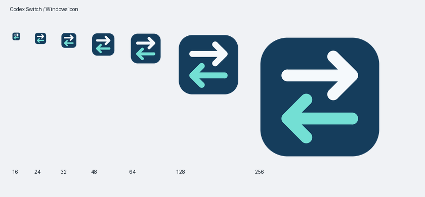

# Codex Switch 图标

深蓝底上的两条箭头表示账号切换。16 像素版加粗了笔画，供 Windows 通知区域使用。

几何源为 `CodexSwitch.svg`。在项目根目录运行 `python assets/generate-icon.py`，用 Pillow 重新生成并校验 ICO。ICO 包含 16、24、32、48、64、128 和 256 像素七帧，四角透明。

构建脚本将图标嵌入 Windows 可执行文件。桌面窗口与托盘使用同一个应用图标。
